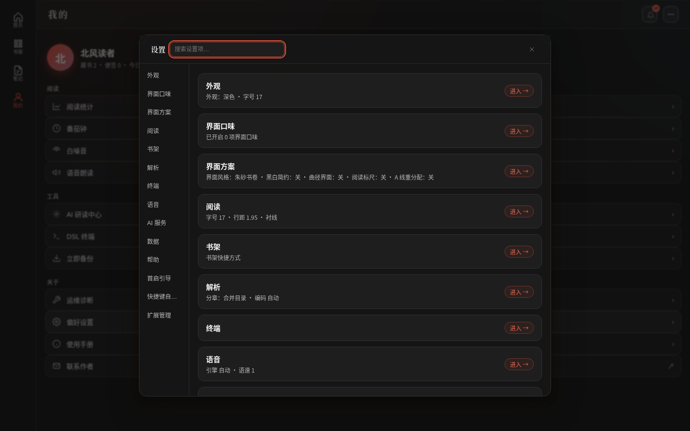
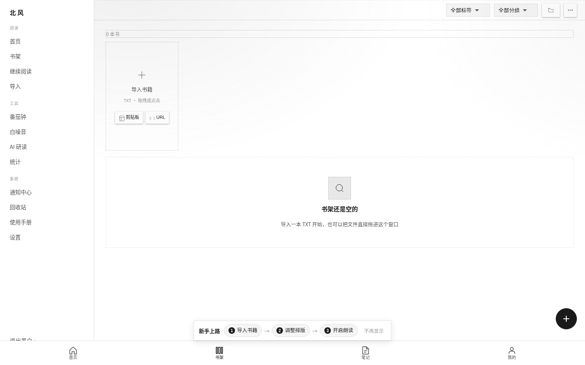

# 北风

一个把书架、阅读器、笔记和听书都装进单个 HTML 文件里的阅读器。

不需要安装，不需要账号，不上传你的书。下载一个文件，就是一整套程序。

[](screenshots/01-reader.png)

## 快速开始

**完整程序只有一个文件：[`北风V0.0.1-alpha.html`](北风V0.0.1-alpha.html)（约 2.9 MB）。** 下载它，就是全部。

| 你想做什么 | 怎么做 |
|---|---|
| 最快读起来 | 双击 `北风V0.0.1-alpha.html`，浏览器直接打开 |
| 书和笔记要能存住 | 双击 `启动北风.bat`（推荐，见下面的原因）——自动选 Python / Node / Windows 自带方式 |
| 想要安装版（开始菜单 + 桌面图标） | 下载 `北风V0.0.1-alpha-Setup.exe`，一路下一步即可 |
| 绿色版想要桌面图标 | 双击 `创建桌面快捷方式.bat`（图标用旁边的 `北风.ico`） |
| 第一次用，缺运行环境 | 启动时会问「要不要现在装 Python？(Y/N)」，答 Y 自动装好并验证；也可先双击 `安装环境.bat`（Python/Node 都能装） |
| 确认文件没下载坏 | 双击 `校验文件.bat`，自动比对官方指纹 |
| 在线直接用 | 打开仓库的 GitHub Pages，无需下载 |

为什么要 `启动北风.bat`：直接双击 HTML 属于 `file://` 方式，Chrome 会禁用本地数据库，书和笔记存不住。启动器会自动挑本机可用的方式（优先 Python，其次 Node，都没有就用 Windows 自带的 PowerShell，无需安装任何东西）开一个只绑本机的服务再打开浏览器，全部功能才完整。这不是程序的缺陷，是浏览器的安全规则。

三个 `.bat` 只在 Windows 上双击运行；macOS / Linux 用户用任意本地静态服务打开仓库根目录即可（如 `python3 -m http.server`）。

## 它是什么

北风是一个离线优先的长文/小说阅读器。所有代码、样式、逻辑都在 `北风V0.0.1-alpha.html` 这一个文件里，大约 4.8 万行，2.9 MB，没有任何运行时依赖。

你的书、进度、划线、笔记、生词本和设置，全部保存在这台设备的浏览器里。程序里没有服务器地址，也没有把正文发出去的代码路径。听书用的是浏览器自带的语音合成；如果你配置了在线语音，连接只走本机回环地址的转发器，密钥不会经过第三方。

它不是一个演示项目。它是能用很久的日常工具——这也是它被这样设计的原因。

## 为什么是单个文件

因为文件是最耐久的交付形式。

一个 HTML 文件可以拷进 U 盘、丢进网盘、发给自己、在十年后双击打开。它不需要 npm install，不需要构建，不会遇到依赖失效。公司会倒闭，CDN 会下线，但一个本地文件只要浏览器还在就能跑。

代价是这个文件会变大、会不好读。为了让它在变大之后还能维护，源码被拆成了 `dev/src/` 下的模板、9 块 CSS 和 181 段 JS，再由工具逐字节拼回单文件。改代码的人编辑 `dev/src/`，使用者只拿成品。

## 现在能做什么

- **书架**：导入 TXT/EPUB 等文本，分章，记录进度，按最近阅读和分类浏览
- **阅读器**：分页或滚动、字号/行距/页边距、白天/夜晚/纸质/护眼多档外观、可换强调色、竖排、黑白模式
- **笔记**：划线、批注、书签、生词本，统计与回顾
- **听书**：浏览器本地语音，可选在线语音；语速、音色、定时、逐词跟随
- **工作台**：总览、存储用量、备份记录、环境与高级工具
- **设置**：外观、阅读、存储分配、快捷键、导入导出，几乎每一项都能自己调
- **研读**：选中文本问 AI、AI 摘要、AI 聚会（需要你自己配置端点；不配置就完全离线）
- **DSL 终端**：程序内置的命令入口，高级操作从这里走

主题取舍、信息密度、交互反馈这些都有过多轮打磨，不是随便堆上去的。

## 界面

| 阅读器 | 书架 |
|---|---|
|  |  |

| 笔记统计 | 工作台 |
|---|---|
|  |  |

| 设置 | 夜间模式 |
|---|---|
|  |  |

## 目录结构

```
北风V0.0.1-alpha.html   完整程序（下载这个，双击即用）
index.html              网页版入口（GitHub Pages 用，内容与上面一致）
启动北风.bat             一键本地服务 + 打开浏览器
安装环境.bat             安装 Python（只需一次）
校验文件.bat             校验下载的文件是否完整
创建桌面快捷方式.bat      给绿色版补一个带图标的桌面快捷方式
北风.ico                 程序图标（快捷方式与安装包都用它）
screenshots/            界面截图
dev/                    开发者区（源码与工具，使用者不用管）
```

## 怎么确认你拿到的是完整的程序

最简单：双击 `校验文件.bat`，它会自动比对官方指纹并给出结论。

手动核对也可以：

```bash
md5sum 北风V0.0.1-alpha.html
# 期望：8e5d5d98c6d6c6297f396d9798ac59ab
wc -lc 北风V0.0.1-alpha.html
# 期望：48081 行 / 2891114 字节
```

程序完整时，仓库根的 `北风V0.0.1-alpha.html` 与 `index.html` 字节完全相同；`dev/` 里的契约副本由 `selfcheck` 自动验证。

## 改代码（开发者）

唯一编辑源是 `dev/src/`：

```
dev/src/index.template.html   页面骨架，190 个占位符
dev/src/styles/01–09.css      9 块样式
dev/src/script/000–180.js     181 段脚本，按功能分区
dev/src/LAYERS.json           分层标注，方便定位
```

改完重新构建并同步：

```bash
node dev/tool/build.mjs      # src/ → 母本
node dev/tool/deploy.mjs     # 母本 → 其余七份（含仓库根发布两份）
```

`dev/tool/` 里是一套只读检查和验收脚本。常用的是 `node dev/tool/selfcheck.mjs`：它会从 `dev/src/` 重新构建母本，检查八份文件字节一致，跑 19 道结构闸门和 266 条行为回归，最后给出能不能交付的结论。日常快速自查用 `node dev/tool/selfcheck.mjs --quick`。细节见 [dev/tool/README.md](dev/tool/README.md)，架构见 [dev/docs/ARCHITECTURE.md](dev/docs/ARCHITECTURE.md)。

本地预览服务（开发者用）：`node dev/tool/serve.mjs 8791`。

## 已知边界

- 数据只在这台设备，没有云同步。换设备要自己导出再导入。
- 文件 2.9 MB，首屏会有极短的解析时间。
- 在线语音需要本机转发器和你自己配置的凭据；不配置就只有本地语音。
- AI 相关功能需要自己填端点，程序本身不内置任何密钥。
- 清理浏览器站点数据会连带清掉书和笔记，记得用程序自带的备份。

## 联系

有问题、建议或想聊聊，写信到 **bytelate@163.com**。程序里「我的 → 关于 → 联系作者」也能直接打开邮件。

## 许可

MIT。做点什么都行，留个出处就好。

## English

**Beifeng** is an offline-first novel reader shipped as a single self-contained HTML file (~48k lines, 2.9 MB, zero runtime dependencies). Download `北风V0.0.1-alpha.html` and open it — that is the whole program. On Windows, `启动北风.bat` starts a local server (install Python once via `安装环境.bat`) so books and notes persist; `校验文件.bat` verifies the download against the official checksum. Books, notes, highlights and settings stay in your browser; nothing is uploaded. Source lives in `dev/src/`, built with `dev/tool/build.mjs`; maintainers verify a checkout with `node dev/tool/selfcheck.mjs`. MIT licensed.
