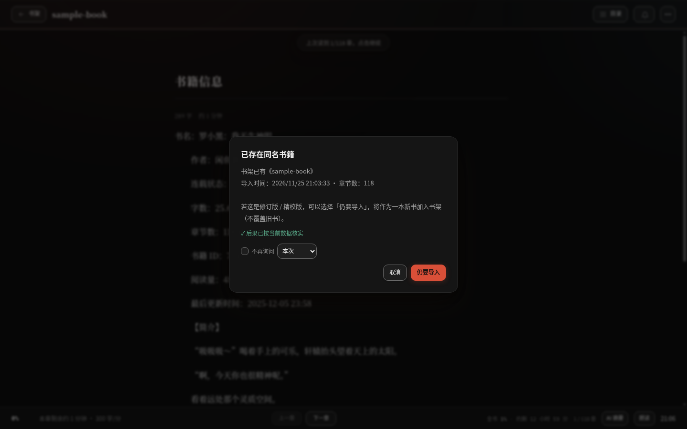
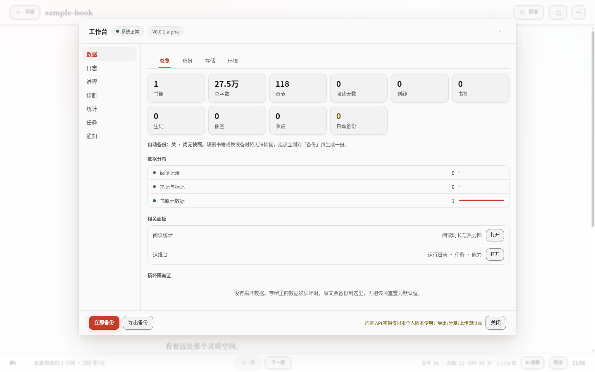
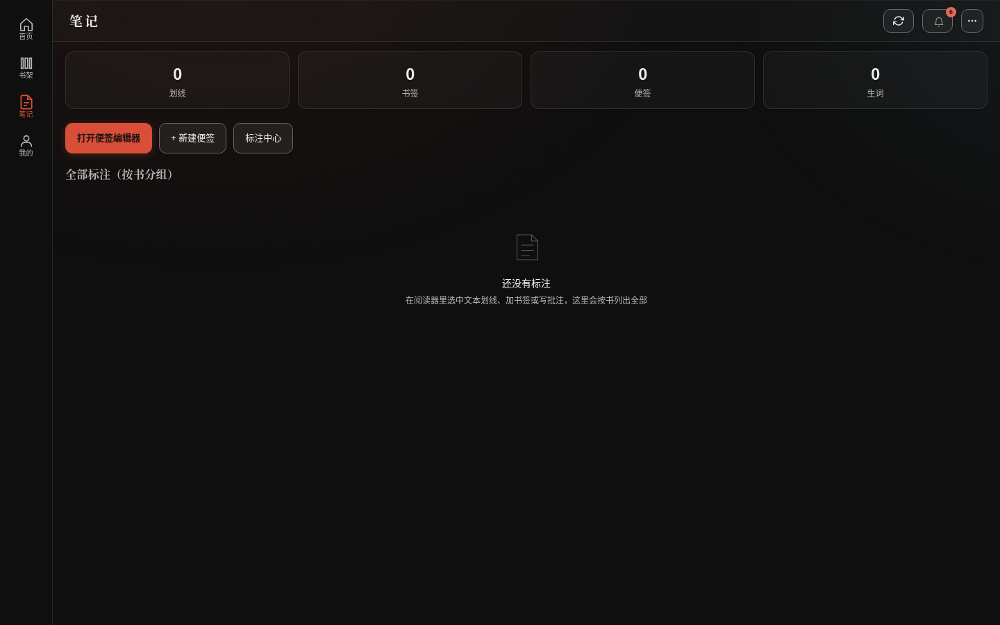
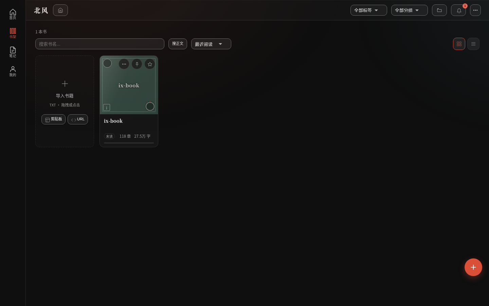

# 北风

一个把书架、阅读器、笔记和听书都装进单个 HTML 文件里的阅读器。

不需要安装，不需要账号，不上传你的书。下载一个文件，就是一整套程序。

[](screenshots/01-reader.png)

## 它是什么

北风是一个离线优先的长文/小说阅读器。所有代码、样式、逻辑都在 `北风V0.0.1-alpha.html` 这一个文件里，大约 4.8 万行，2.9 MB，没有任何运行时依赖。

你的书、进度、划线、笔记、生词本和设置，全部保存在这台设备的浏览器里。程序里没有服务器地址，也没有把正文发出去的代码路径。听书用的是浏览器自带的语音合成；如果你配置了在线语音，连接只走本机回环地址的转发器，密钥不会经过第三方。

它不是一个演示项目。它是能用很久的日常工具——这也是它被这样设计的原因。

## 为什么是单个文件

因为文件是最耐久的交付形式。

一个 HTML 文件可以拷进 U 盘、丢进网盘、发给自己、在十年后双击打开。它不需要 npm install，不需要构建，不会遇到依赖失效。 Corporations 会倒闭，CDN 会下线，但一个本地文件只要浏览器还在就能跑。

代价是这个文件会变大、会不好读。为了让它在变大之后还能维护，源码被拆成了 `src/` 下的模板、9 块 CSS 和 181 段 JS，再由 `tool/build.mjs` 逐字节拼回单文件。改代码的人编辑 `src/`，使用者只拿成品。

## 现在能做什么

- **书架**：导入 TXT/EPUB 等文本，分章，记录进度，按最近阅读和分类浏览
- **阅读器**：分页或滚动、字号/行距/页边距、白天/夜晚/纸质/护眼多档外观、可换强调色、竖排、黑白模式
- **笔记**：划线、批注、书签、生词本，统计与回顾
- **听书**：浏览器本地语音，可选在线语音；语速、音色、定时、逐词跟随
- **工作台**：总览、存储用量、备份记录、环境与高级工具
- **设置**：外观、阅读、存储分配、快捷键、导入导出，几乎每一项都能自己调
- **研读**：选中文本问 AI、AI 摘要、AI 聚会（需要你自己配置端点；不配置就完全离线）
- **DSL 终端**：程序内置的命令入口，高级操作从这里走

主题取舍、信息密度、交互反馈这些都有过多轮打磨，不是随便堆上去的。

## 跑起来

**最简单**：用浏览器打开 `index.html` 或 `北风V0.0.1-alpha.html`。

**推荐**（本地服务，数据功能才完整）：

```bash
node tool/serve.mjs 8791
# 打开 http://127.0.0.1:8791
```

为什么要本地服务：`file://` 是不透明源，Chrome 会禁用 IndexedDB，书和笔记就存不住。本地服务或 GitHub Pages 这类 http(s) 环境才让全部功能生效。这不是程序的缺陷，是浏览器的安全规则。

如果启用了 GitHub Pages，直接访问仓库主页就能用——`index.html` 会带你进程序。

## 界面

| | |
|---|---|
|  |  |
|  |  |
|  |  |

## 代码在哪，怎么改

唯一编辑源是 `src/`：

```
src/index.template.html   页面骨架，190 个占位符
src/styles/01–09.css      9 块样式
src/script/000–180.js     181 段脚本，按功能分区
src/LAYERS.json           分层标注，方便定位
```

改完重新构建并同步：

```bash
node tool/build.mjs      # src/ → 根 txt
node tool/deploy.mjs     # 同步六份副本
```

`tool/` 里是一套只读检查和验收脚本。常用的是 `node tool/selfcheck.mjs`：它会从 `src/` 重新构建母本，检查六份文件字节一致，跑 19 道结构闸门和 266 条行为回归，最后给出能不能交付的结论。日常快速自查用 `node tool/selfcheck.mjs --quick`。细节见 [tool/README.md](tool/README.md)。

## 怎么确认你拿到的是完整的程序

```bash
md5sum 北风V0.0.1-alpha.txt
# 期望：3bb0502f5280f4aefe2b7f74f8022a6a
wc -lc 北风V0.0.1-alpha.txt
# 期望：48081 行 / 2891305 字节
```

六份副本（根目录两份、`work/` 两份、`pre/target/` 两份）字节完全相同。`selfcheck` 会自动验证这件事。

## 已知边界

- 数据只在这台设备，没有云同步。换设备要自己导出再导入。
- 文件 2.9 MB，首屏会有极短的解析时间。
- 在线语音需要本机转发器和你自己配置的凭据；不配置就只有本地语音。
- AI 相关功能需要自己填端点，程序本身不内置任何密钥。
- 清理浏览器站点数据会连带清掉书和笔记，记得用程序自带的备份。

## 联系

有问题、建议或想聊聊，写信到 **bytelate@163.com**。程序里「我的 → 关于 → 联系作者」也能直接打开邮件。

## 许可

MIT。做点什么都行，留个出处就好。

## English

**Beifeng** is an offline-first novel reader shipped as a single self-contained HTML file (~48k lines, 2.9 MB, zero runtime dependencies). Books, notes, highlights and settings stay in your browser; nothing is uploaded. It includes a bookshelf, a configurable reader, annotations, text-to-speech, themes, and an optional local AI endpoint. Built from `src/` with `tool/build.mjs`; verify a checkout with `node tool/selfcheck.mjs`. MIT licensed.
